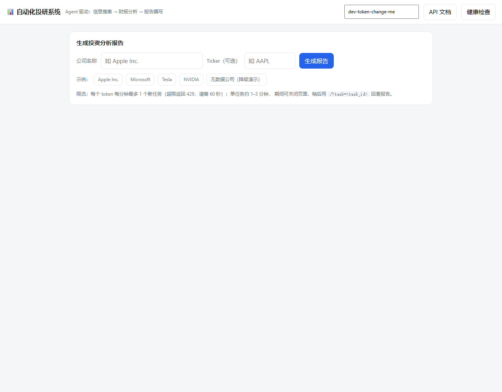
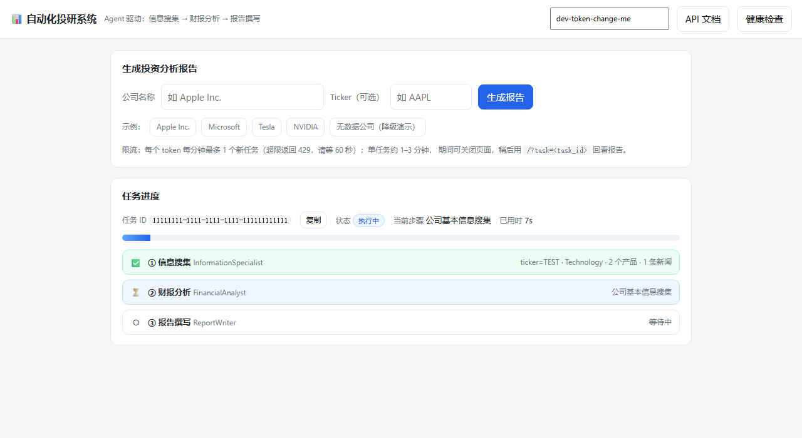
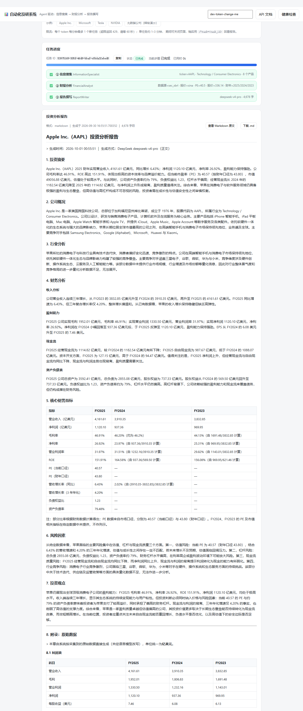
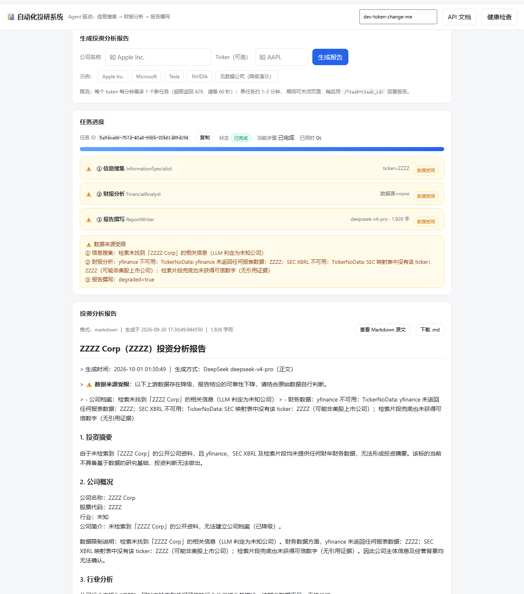
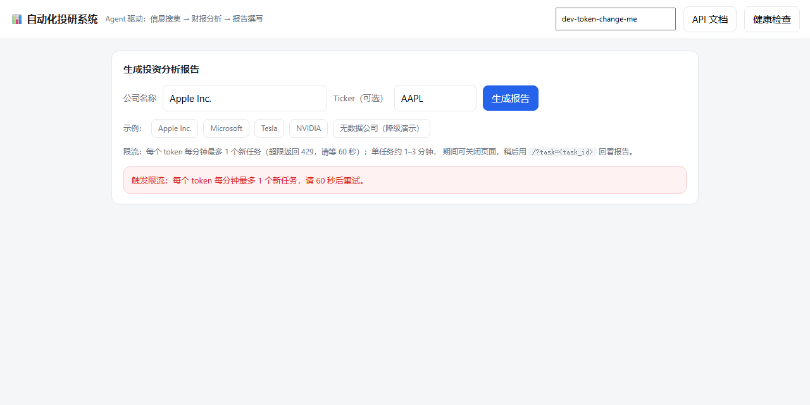

# Agent 驱动的自动化投研系统

> 作者：ZRZ ｜ 时间：2026-09-30 ~ 2026-10-01 ｜ 配套项目：[RAG 智能客服（项目一）](https://github.com/ZRZ-sc/rag-customer-service)——检索增强问答与高并发，与本项目同机部署（端口错开：5433/6380 vs 5432/6379）

输入一个公司名，系统自动完成 **信息搜集 → 财报分析 → 报告撰写**，输出一份带真实财务数据与原始数据附录的投资分析报告。
面向「分析师重复劳动」场景：把散落在检索、财报、行情里的信息收敛成标准化报告，全流程可审计、可降级、可回看。

## 项目亮点（可直接引用）

- **基于 CrewAI 构建 3 Agent 顺序工作流**（信息搜集 → 财报分析 → 报告撰写），25 条四类评测集（正常美股/中文名/无数据/边界）**任务成功率 100%（25/25，需求 N1 >95%）**，**平均 61.5s、P50 58.7s、P99 103.9s**（需求 N2 <8 分钟）
- **设计多级数据源降级链**：财报 `yfinance → SEC XBRL → Bing 片段抽取 → degraded`，报价 `yfinance → 新浪 → 腾讯`，搜索 `DuckDuckGo → Bing`；在 **Yahoo 对本机 IP 持续限流 + DuckDuckGo/Wikipedia 被墙**的网络环境下，仍稳定产出真实财报（Apple FY2025 营收 4,161.61 亿美元、PE 40.52）
- **评测中定位并修复 5 个真实缺陷**：并发连接池竞争（首轮成功率 **80% → 100%**）、**SEC 限流伪装成 404** 导致误判「公司无财报」（改用 `companyfacts` 单请求后财报步 **14s → 3s**）、20-F 外国私人发行人（阿里）支持、信息搜集过度保守（真实公司误判 unknown）、客户端 keep-alive 传输重试
- **可观测与容错**：任务/步骤/Agent/工具四层 Prometheus 指标（成功率、分步耗时、降级次数）、Loguru JSON 日志、Celery 硬超时 900s + 指数退避重试 + `acks_late`、单步降级不中断整任务；中间产出逐步落库支持审计与断点回看
- **工程实现**：32 个 Python 文件 / 4,941 行 + 413 行零依赖前端；`/ready` 三依赖探针、Bearer 鉴权 + 按 token 限流（每 token 每分钟 1 个任务）、9 个服务容器化编排、25 条评测脚本支持断点续跑

## 系统架构

```
用户（浏览器 Web 界面 / REST API）
   │  公司名（+ 可选 ticker）
   ▼
┌─ 入口层 ───────────────────────────────────────────────────────────────┐
│  FastAPI  POST /api/v1/research   任务创建（Bearer 鉴权 N6 + 按 token 限流）│
│           GET  /api/v1/research/{task_id}         状态/进度/中间产出      │
│           GET  /api/v1/research/{task_id}/report  最终报告               │
│           GET  /（Web 界面 F7）· /docs · /health · /ready · /metrics     │
└────────────────────────────────────────────────────────────────────────┘
   │  ① 落库 research_tasks(status=queued)   ② 投递 Celery（.delay）
   ▼
┌─ 异步任务层 ───────────────────────────────────────────────────────────┐
│  Celery Worker：并发 3（N7）· 硬超时 900s · 软超时 840s · 失败指数退避重试（F6）│
│  Redis 分工：db0 限流+缓存 ｜ db1 broker ｜ db2 result backend            │
│  acks_late=True + reject_on_worker_lost：worker 崩溃任务回队列，不丢单      │
└────────────────────────────────────────────────────────────────────────┘
   │
   ▼
┌─ CrewAI Sequential Process（三步工作流，需求 3.3）────────────────────────┐
│  ① 信息搜集专家 InformationSpecialist —— DeepSeek V4 Flash              │
│     工具：duckduckgo_search → bing_search ｜ wikipedia_search ｜ ticker_lookup │
│     产出：company_profile（简介/行业/产品/竞争对手/ticker/近期新闻）        │
│  ② 财务分析师 FinancialAnalyst —— DeepSeek V4 Flash                     │
│     工具：yahoo_finance → sec_financials(SEC XBRL) → bing_search         │
│     产出：financial_metrics（近 3 年三表 + PE/ROE/毛利率/增长率）+ trends   │
│  ③ 投资报告撰写专家 ReportWriter —— DeepSeek **V4 Pro**（质量优先）         │
│     产出：8 章 Markdown（第 8 章「附录：原始数据」由代码按真实 JSON 生成）    │
│  ── 每步产出 Pydantic 校验，失败重试 2 次，仍失败则降级并继续（需求 3.7）──    │
└────────────────────────────────────────────────────────────────────────┘
   │  每步产出落库（F5 审计）
   ▼
┌─ 存储层 ───────────────────────────────────────────────────────────────┐
│  PostgreSQL 15：research_tasks / task_outputs / research_reports        │
│  Redis 7：令牌桶限流 · Celery broker · 结果后端 · 可达性冷却             │
│  文件：data/reports/{task_id}.md（报告）· data/filings · data/parsed（预留）│
└────────────────────────────────────────────────────────────────────────┘
   │
   ▼
┌─ 可观测性（N4）────────────────────────────────────────────────────────┐
│  Prometheus 指标：任务成功率/时长 · 分步与 Agent 耗时 · 工具调用与降级 · Token │
│  Loguru JSON 日志：request_id 贯穿 · task_id/agent/tool 结构化字段          │
└────────────────────────────────────────────────────────────────────────┘
```

## 功能清单

| 编号 | 需求 | 优先级 | 状态 | 实现要点 |
|---|---|---|---|---|
| F1 | 输入公司名触发完整流程 | P0 | ✅ | `POST /api/v1/research` → 落库 + 投递 Celery，异步执行 |
| F2 | 信息搜集 Agent | P0 | ✅ | 4 工具（DuckDuckGo/Bing/Wikipedia/ticker 查询）+ 检索降级链 |
| F3 | 财报分析 Agent | P0 | ✅ 结构化数据版 | `yfinance → SEC XBRL(10-K/20-F) → Bing 片段抽取`；**PDF 下载 + MinerU 解析为后续增强** |
| F4 | 报告撰写 Agent | P0 | ✅ | 8 章结构（投资摘要→附录），附录由代码生成保证数字零失真 |
| F5 | 中间产出记录 + 审计/人工干预 | P1 | 🟡 审计 ✅ / 干预预留 | 每步产出落 `task_outputs`，可查可回看；暂停/修正接口未实现 |
| F6 | 失败自动重试，成功率 >95% | P0 | ✅ 100% | Celery 重试 + 单步降级不中断 + 超时兜底标记 failed |
| F7 | Web 界面 | P2 | ✅ | 单文件 `app/static/index.html`：提交 → 轮询进度 → marked 渲染报告 |

非功能需求：

| 编号 | 需求 | 目标 | 实测 |
|---|---|---|---|
| N1 | 任务成功率（含自动重试） | >95% | **100%（25/25）** ✅ |
| N2 | 单任务完成时间 | <8 分钟 | **平均 61.5s / P99 103.9s** ✅ |
| N3 | 集成 ≥5 个工具，每个有降级方案 | ≥5 | **6 个工具 + 全链路降级矩阵** ✅ |
| N4 | LangSmith 追踪 + 自定义日志 | — | 结构化日志 ✅ / **LangSmith 未接入**（网络不可达） |
| N5 | Agent/工具热插拔 | — | 🟡 模块化 + 配置驱动；无插件注册机制 |
| N6 | API 鉴权，防未授权触发 | — | Bearer 鉴权 + 按 token 限流 + 审计接口独立 token ✅ |
| N7 | 并发控制，防资源耗尽 | — | Celery 并发 3 + 应用层「每 token 每分钟 1 个任务」✅ |

## 核心指标速览

| 维度 | 指标 | 实测 | 需求 |
|---|---|---|---|
| 成功率 | 任务成功率（含自动重试） | **100%（25/25）** | >95% |
| 耗时 | 平均 / P50 / P99 / 最长 | **61.5s / 58.7s / 103.9s / 103.9s** | <8 分钟 |
| 分步耗时 | 信息搜集 / 财报分析 / 报告撰写 | **16.7s / 11.1s / 33.6s**（报告占 55%） | — |
| 降级 | 降级率（存在 degraded 步骤） | **24%（6/25）**：5 个预期降级（无数据样本）+ 腾讯 ADR | — |
| 分类别成功率 | 美股 / 中文名 / 无数据 / 边界 | **100% / 100% / 100% / 100%** | — |
| 分类别降级率 | 美股 / 中文名 / 无数据 / 边界 | **0% / 20% / 100% / 0%** | — |
| 成本 | 单任务 Token（真实公司 / 无数据） | **25–35K / ~6K**，25 条评测约 60 万 | — |
| 规模 | 代码量 / 评测集 / 报告产物 | 4,941 行 / 25 条 4 类 / 49 份 | — |

> 完整评测报告（分类别、逐条明细、瓶颈定位、工程发现）：[`docs/research_eval_report.md`](docs/research_eval_report.md)

## 技术栈

| 层 | 选型 | 说明 |
|---|---|---|
| 多 Agent 编排 | CrewAI 1.15（Sequential Process） | Agent-Role-Task + 工具调用；单任务单 Crew，关闭执行追踪（headless 非交互） |
| LLM | DeepSeek V4 Flash / **V4 Pro** | 信息搜集与财报分析用 Flash（性价比），报告撰写用 Pro（质量优先，可切换） |
| Web | FastAPI + uvicorn | 异步接口 + Bearer 鉴权 + 统一错误码 + 请求 ID 贯穿 |
| 异步任务 | Celery 5.6 + Redis 7 | broker/result 分库；并发 3、硬超时 900s、指数退避重试、acks_late |
| 关系库 | PostgreSQL 15（asyncpg） | 任务/中间产出/报告三表；连接池**按线程隔离**（见下文「踩坑记录」） |
| 检索 | DuckDuckGo(`ddgs`) / Bing HTML / Wikipedia | 免 API Key；DuckDuckGo 与 Wikipedia 在本机网络不可达时自动降级 Bing |
| 财报 | yfinance + SEC EDGAR XBRL | 只调 SEC 结构化 JSON（`companyfacts`），**不下载 10-K、不用 MinerU** |
| 行情 | 新浪 / 腾讯行情接口 | 免 Key；带占位数据校验（防「不存在的 ticker」被当成真实行情） |
| 校验 | Pydantic v2 | 每个 Agent 输出强校验 + 失败重试 + 降级兜底 |
| 前端 | 原生 HTML/JS + marked 15 | 零构建、零 CDN 依赖（marked 已本地化到 `app/static/vendor/`） |
| 可观测性 | Prometheus + Loguru(JSON) | 指标 4 层 + 结构化日志 |
| 部署 | Docker + Docker Compose | 基础设施编排 + 应用镜像（api/worker 双 target）+ Nginx 反代 |

## 目录结构

```
app/
├── main.py                     # FastAPI 入口：任务接口 + 探针 + 指标 + Web 界面挂载
├── config.py                   # pydantic-settings 配置（.env / .env.local）
├── api/
│   ├── deps.py                 # Bearer 鉴权（业务 token / admin token 双通道）
│   └── routes/research.py      # 投研任务接口（创建 / 状态 / 报告）
├── agents/
│   ├── info_collector.py       # ① 信息搜集 Agent（+ Pydantic 校验 / 证据分档）
│   ├── financial_analyst.py    # ② 财务分析 Agent（三级数据源编排）
│   └── report_writer.py        # ③ 报告撰写 Agent（8 章 + 确定性附录 + 模板降级）
├── tools/
│   ├── web_search.py           # DuckDuckGo / Bing / Wikipedia（可达性预检 + 冷却）
│   ├── ticker_lookup.py        # 本地 28 家映射表 → LLM 兜底
│   ├── yahoo_finance.py        # yfinance 三表 + 指标计算 + 报价降级（新浪/腾讯）
│   ├── sec_financials.py       # SEC XBRL companyfacts（一次拿全 + 全局节流）
│   └── report_writer.py        # 报告落盘工具
├── worker/
│   ├── celery_app.py           # Celery 实例（并发/超时/重试/队列）
│   └── tasks.py                # 三步工作流编排 + 进度/指标/落库/超时兜底
├── db/
│   ├── postgres.py             # 连接池（**线程隔离**）
│   └── redis.py                # 客户端（缓存/限流 + broker 探针）
├── services/rate_limit.py      # Redis 令牌桶（Lua 原子扣减，fail-open）
├── core/                       # 错误码 / 结构化日志 / 脱敏 / Prometheus 指标
└── static/                     # F7 前端：index.html + vendor/marked.min.js
scripts/
├── init_db.py                  # 建表（幂等）
├── eval_research.py            # N1 评测：流水线提交 + 统计 + 生成报告（支持断点续跑）
├── infra_up.ps1                # 基础设施启停（WSL + Docker，含保活）
└── monitoring_up.ps1           # 监控栈启停（预留）
data/
├── eval/research_eval_set.json # 25 条评测集（四类）
├── eval/research_eval_results.json  # 逐条结果（gitignore）
└── reports/                    # 生成的报告（gitignore）
docs/
├── research_eval_report.md     # N1/N2 评测报告
├── environment_notes.md        # 环境适配与本机事故复盘
└── interview_qa.md             # 面试问答手册（20 题三段式）
docker-compose.infra.yml        # PostgreSQL + Redis（不含 Milvus）
Dockerfile                      # api / worker 双 target
nginx/nginx.conf                # 反向代理 + 入口限流
requirements.txt
```

## 快速开始

```powershell
# ① 基础设施（PostgreSQL 5433 + Redis 6380；-Keepalive 窗口需保持打开）
powershell -ExecutionPolicy Bypass -File scripts\infra_up.ps1 -Keepalive

# ② 建表（幂等，可重复执行）
.\.venv\Scripts\python.exe scripts\init_db.py

# ③ FastAPI（另开窗口；Web 界面与 API）
.\.venv\Scripts\python.exe -m uvicorn app.main:app --host 0.0.0.0 --port 8000 --timeout-keep-alive 15

# ④ Celery Worker（另开窗口；-P threads 为 Windows 必需）
.\.venv\Scripts\python.exe -m celery -A app.worker.celery_app worker -Q research -c 3 -P threads -l INFO
```

依赖安装（首次）：

```powershell
python -m venv .venv
.\.venv\Scripts\python.exe -m pip install -r requirements.txt -i https://pypi.tuna.tsinghua.edu.cn/simple
```

`.env` 至少需要：`DEEPSEEK_API_KEY`（必填，报告与 Agent 都要用）。
端口与项目一共存时改 `.env.local`：`PG_PORT=5433`、`REDIS_PORT=6380`、三个 Redis URL 同步改端口。

## Web 界面使用步骤（F7）

1. 浏览器打开 **http://127.0.0.1:8000/**（经 Nginx 亦可：http://localhost:8080/）
2. 点示例按钮 **Apple Inc.**（自动填 Apple Inc. / AAPL）→ 点「生成报告」
3. 页面显示 **任务 ID + 进度条 + 当前步骤**，每 2.5s 轮询：
   - 进度 5% → 33% → 67% → 100%，三步时间线依次变绿并显示每步摘要
     （`① 信息搜集 ticker=AAPL · Technology / Consumer Electronics · 8 个产品`
     `② 财报分析 数据源=sec_xbrl · 报价=sina · PE=40.5 · 股价=336.14`
     `③ 报告撰写 deepseek-v4-pro · 4,678 字`）
   - 完成后自动拉取报告并用 marked 渲染，可「查看 Markdown 原文」/「下载 .md」
4. **降级演示**：点「无数据公司（降级演示）」→ 顶部出现 **⚠️ 数据来源受限** 警示，各章显示「数据不足」，任务仍 `completed` 不崩溃
5. 深链（可分享/回看）：`/?company=Apple+Inc.&ticker=AAPL&auto=1` 自动提交；`/?task=<task_id>` 回看历史报告

> 右上角 Token 输入框默认填 `.env` 的默认 token，改动存 localStorage；上线前务必更换 `API_TOKEN`。

### 界面预览（无头 Chrome 对运行中的系统实测截图）

| ① 提交表单（示例公司一键填充） | ② 执行中：进度条 + 三步时间线 + 每步摘要 |
|---|---|
|  |  |

**③ 报告页**：8 章 Markdown 渲染，含核心财务指标表格与「附录：原始数据」（由代码按 JSON 生成，数字零失真）



| ④ 降级演示：无数据公司（顶部「数据来源受限」+ 三步 ⚠️ 标记 + 逐条原因） | ⑤ 限流提示：429 转为可读文案（原实现把错误框放在隐藏卡片里，用户看不到——评测中修掉） |
|---|---|
|  |  |

## API 一览

| 接口 | 说明 | 备注 |
|---|---|---|
| `POST /api/v1/research` | 创建投研任务 | Bearer 鉴权；**每 token 每分钟 1 个任务**，超限 429 |
| `GET /api/v1/research/{task_id}` | 状态/进度/中间产出 | 返回 `progress`、`current_step`、`intermediate_outputs`、`report_url` |
| `GET /api/v1/research/{task_id}/report` | 最终报告 | Markdown 正文 + 格式 + 生成时间；未完成返回 404 |
| `GET /health` `/ready` | 存活 / 就绪探针 | `/ready` 检查 PostgreSQL + Redis + Celery broker，任一不可用返回 503 |
| `GET /metrics` | Prometheus 指标 | 见下「可观测性」 |
| `GET /` `/static/*` | Web 界面与静态资源 | `app/static/index.html` + 本地化 marked |

错误码统一为 `{"code":0,"message":"...","data":{...}}`：401 鉴权失败 / 404 任务不存在 / 422 参数校验 / 429 限流（带 `Retry-After`）/ 503 队列不可用。

## 核心流程详解（三步各自做了什么）

### Task 1 信息搜集（InformationSpecialist，DeepSeek Flash，平均 16.7s）

```
① ticker 解析  本地 28 家映射表（含中英文别名）→ 未命中走 LLM 兜底 → 再用 SEC 备案交叉验证
② 资料预取     Wikipedia 摘要 → 公司与行业检索 → 近期新闻检索（每步都有降级与冷却）
③ CrewAI 执行  Agent + 4 个工具（LLM 还可自行补充检索，实测平均自主检索 3–7 次）
④ 输出校验     JSON 容错提取 → CompanyProfile 校验（失败回传错误重试，最多 2 次）
⑤ 落库         company_profile：简介/行业/产品/竞争对手/ticker/近期新闻 + data_sources
```

反幻觉与反过度保守：资料与公司无关时必须返回 `unknown_company=true`（无数据公司走这条路）；
但若 ticker 有硬证据（本地表/调用方/SEC 备案），提示词会明确"该公司确实存在"，避免真实公司被误判降级。

### Task 2 财报分析（FinancialAnalyst，DeepSeek Flash，平均 11.1s）

```
① 主数据源   yfinance：三大报表 + fast_info 报价（本机被 Yahoo 限流，自动降级）
② 备用数据源 SEC EDGAR XBRL：companyfacts 一次拿全（支持 10-K / 20-F）
             → 按 Tag 优先级匹配 → 过滤年报口径（fp=FY 且跨度≈365 天）
③ 报价补充   新浪行情 → 腾讯行情（带占位数据校验：价格/市值必须有效）
④ 指标计算   PE（行情 TTM 口径 + 财年口径各记一份）/ ROE / 毛利率 / 净利率 /
             营业利润率 / 营收增速（YoY + CAGR）/ 负债权益比 / 资产负债率
⑤ LLM 解读   把真实数字压成清单交给模型，只让它产出 summary + trends（禁止引入清单外的数字）
```

### Task 3 报告撰写（ReportWriter，**DeepSeek Pro**，平均 33.6s）

```
① 数据包     公司档案 + 近 3 年三表 + 核心指标 + 前两步的既有结论 + 数据限制说明
② LLM 生成   严格 7 个二级标题（投资摘要/公司概况/行业分析/财务分析/核心财务指标/风险因素/投资观点）
             缺章节或超时 → 重试 2 次 → 仍失败回结构化模板（占位符）
③ 附录追加   第 8 章「附录：原始数据」由代码按 JSON 直接生成表格（三表 + 核心指标 + 数据来源），
             不经过 LLM，保证数字零失真
④ 落盘       写 data/reports/{task_id}.md + 落库 research_reports；状态接口只返回元信息
⑤ 降级标注   任一上游 degraded → 报告顶部插入「数据来源受限」清单
```

## 接口示例

```jsonc
// POST /api/v1/research   （Authorization: Bearer <API_TOKEN>）
// 请求
{ "company_name": "Apple Inc.", "ticker": "AAPL" }
// 响应
{ "code": 0, "message": "Task created successfully",
  "data": { "task_id": "53975169-305f-46d9-bbaf-c0bda32ebed8", "status": "queued", "estimated_time": 480 } }

// GET /api/v1/research/{task_id}
{ "code": 0, "message": "success",
  "data": {
    "task_id": "53975169-...", "company_name": "Apple Inc.", "ticker": "AAPL",
    "status": "running", "progress": 0.67, "current_step": "投资价值分析与报告撰写",
    "intermediate_outputs": {
      "company_profile": { "ticker": "AAPL", "sector": "Technology / Consumer Electronics", "products": ["iPhone", "..."], "degraded": false },
      "financial_metrics": { "data_source": "sec_xbrl", "quote_source": "sina", "fiscal_years": ["2025","2024","2023"],
                             "key_metrics": { "pe_ratio": 40.52, "roe": 1.5191, "gross_margin": 0.4691 },
                             "degraded": false },
      "investment_report": null
    },
    "report_url": null, "error_message": null, "retry_count": 0,
    "created_at": "2026-10-01T00:55:51", "completed_at": null } }

// GET /api/v1/research/{task_id}/report
{ "code": 0, "message": "success",
  "data": { "report_content": "# Apple Inc.（AAPL）投资分析报告\n\n## 1. 投资摘要...",
            "report_format": "markdown", "report_path": "./data/reports/53975169-....md",
            "generated_at": "2026-10-01T00:55:51.700352" } }

// 限流 / 鉴权失败
{ "code": 429, "message": "每个 token 每分钟最多触发 1 个新任务，请 60 秒后重试", "data": { "scope": "task_create", "retry_after": 60 } }
{ "code": 401, "message": "未认证或token无效；请在请求头中传递 Authorization: Bearer <API_TOKEN>", "data": null }
```

## 工作流与数据模型

三步工作流（需求 3.3）：**ticker 是上下游契约** —— 第一步解析出的 `ticker` 会自动传给第二步，第二步的财务数据与第一步的公司档案一起传给第三步。

```sql
research_tasks  (task_id UUID PK, company_name, ticker, status, progress, current_step,
                 created_at, completed_at, error_message, retry_count, timeout_at, callback_url)
task_outputs    (task_id → research_tasks, step, output_json JSONB, created_at)
                UNIQUE(task_id, step)  -- 重跑覆盖，保证审计只有一份最新产出
research_reports(task_id → research_tasks, report_path, report_content, word_count, created_at)
```

### 完整 DDL（`scripts/init_db.py`，幂等可重复执行）

```sql
CREATE TABLE IF NOT EXISTS research_tasks (
    task_id UUID PRIMARY KEY,
    company_name VARCHAR(100),
    ticker VARCHAR(10),
    status VARCHAR(20) NOT NULL DEFAULT 'queued',   -- pending/queued/running/completed/failed/need_human
    created_at TIMESTAMP DEFAULT NOW(),
    completed_at TIMESTAMP,
    error_message TEXT,
    retry_count INT DEFAULT 0,                      -- 自动重试次数（评测成功率口径依赖）
    timeout_at TIMESTAMP,                           -- 超时上限（默认 900s）
    progress FLOAT DEFAULT 0,                       -- 供状态接口
    current_step VARCHAR(50),                       -- 供状态接口
    callback_url VARCHAR(500),                      -- 预留：完成回调（尚未发起）
    CONSTRAINT ck_research_tasks_status CHECK (
        status IN ('pending','queued','running','completed','failed','need_human'))
);

CREATE TABLE IF NOT EXISTS task_outputs (           -- F5：每步中间产出（审计）
    id SERIAL PRIMARY KEY,
    task_id UUID REFERENCES research_tasks(task_id) ON DELETE CASCADE,
    step VARCHAR(50),                               -- profile / financials / report
    output_json JSONB,
    created_at TIMESTAMP DEFAULT NOW()
);

CREATE TABLE IF NOT EXISTS research_reports (
    id SERIAL PRIMARY KEY,
    task_id UUID REFERENCES research_tasks(task_id) ON DELETE CASCADE,
    report_path VARCHAR(500),
    report_content TEXT,
    word_count INT,
    created_at TIMESTAMP DEFAULT NOW()
);

CREATE INDEX  IF NOT EXISTS idx_research_tasks_status ON research_tasks(status, created_at DESC);
CREATE INDEX  IF NOT EXISTS idx_research_tasks_ticker ON research_tasks(ticker);
CREATE UNIQUE INDEX IF NOT EXISTS uq_task_outputs_task_step ON task_outputs(task_id, step);  -- 重跑覆盖
CREATE INDEX  IF NOT EXISTS idx_research_reports_task ON research_reports(task_id);
```

## 部署（容器化）

### 基础设施（PostgreSQL + Redis，2 个服务）

```bash
# 本机（Docker 引擎在 WSL 内）推荐用脚本：powershell -File scripts\infra_up.ps1
docker compose --env-file .env --env-file .env.local -f docker-compose.infra.yml up -d
```

- 容器名 `research-postgres` / `research-redis`，宿主端口 **5433 / 6380**（避开项目一的 5432/6379），容器内仍是 5432 / 6379。
- Redis 同时承担 Celery broker(db1) 与结果后端(db2)，故开启 AOF + `noeviction`，避免重启丢队列。
- **不含 Milvus/etcd/minio**：本项目无向量检索，编排里只保留 PostgreSQL + Redis（这也是与项目一编排的主要差异）。

### 应用镜像（api / worker 双 target，同一份依赖层）

```bash
docker build --target api    -t research-agent-api:latest .
docker build --target worker -t research-agent-worker:latest .
```

| 特性 | 说明 |
|---|---|
| 基础镜像 | `python:3.12-slim` + `libgl1`/`libglib2.0-0`（MinerU/opencv 运行时）+ `tini`（信号转发） |
| 角色 | `api` → uvicorn + `/health` 健康检查；`worker` → `celery -A app.worker.celery_app worker -Q research` + `celery inspect ping` 健康检查 |
| 安全 | 非 root（uid 10001）、不打包任何密钥（走 env_file / environment） |
| 数据目录 | `/srv/data/{filings,parsed,reports}` 由卷挂载承接 |
| 优雅退出 | `tini` + worker 用 `sh -c "exec celery …"`，确保 SIGTERM 能传到 celery 而不是被 sh 吞掉 |

### Nginx 入口

`upstream research_app → app:8000`；创建任务接口按 IP `6r/m` 严格限流（应用层再按 token 限 1 次/分钟，两层职责不同）；
`/metrics` 仅内网白名单；请求 ID 透传；JSON 访问日志。

> 当前本机开发形态是「infra 用容器 + 应用用 venv 直跑」（便于热重载）；把 api/worker/nginx 三个服务写进全栈 compose 即可一键部署，
> 两个 target 复用同一镜像，worker 只需覆盖启动命令。

## 降级策略矩阵（实测生效）

| 环节 | 主数据源 | 降级 1 | 降级 2 | 兜底 |
|---|---|---|---|---|
| 网页搜索 | DuckDuckGo | Bing（HTML 解析） | — | LLM 自身知识（标注来源） |
| 百科 | Wikipedia | Bing 检索 | — | 跳过该段资料 |
| ticker 解析 | 本地 28 家映射表 | LLM 兜底 + **SEC 备案交叉验证** | — | 返回未命中（后续步骤标记降级） |
| 财务报表 | yfinance | **SEC XBRL `companyfacts`**（10-K / 20-F） | Bing 片段 + LLM 严格抽取（需 `evidence` 引用，无证据即丢弃） | `degraded=true` + 兜底描述 |
| 行情报价 | yfinance | 新浪行情 | 腾讯行情 | 占位数据校验后置空（防假数据） |
| 报告正文 | DeepSeek Pro | 重试 2 次 | 结构化模板（占位符，附录仍为真实数据） | — |

降级判定与传播：单步 `degraded=true` **不中断**任务；报告顶部插入「数据来源受限」警示，附录列出每个降级项的具体原因。

## 可观测性

| 指标 | 说明 |
|---|---|
| `research_tasks_total{status}` / `research_task_success_rate` | 任务数按终态、滑动窗口成功率（N1 直读） |
| `research_task_duration_seconds` / `research_task_timeouts_total` | 任务端到端时长、超时次数（N2） |
| `research_step_duration_seconds{step}` / `research_steps_total{step,status}` | 三步各自耗时与成功/降级计数 |
| `agent_execution_duration_seconds{agent}` / `agent_validation_failures_total{agent}` | Agent 执行时长、输出校验失败（3.7 重试依据） |
| `tool_duration_seconds{tool}` / `tool_calls_total` / `tool_fallbacks_total` | 工具耗时、调用结果、降级次数（N3） |
| `llm_request_duration_seconds` / `llm_tokens_total{model,type}` | LLM 调用耗时与 Token |
| `research_tasks_in_progress` / `research_task_queue_length` | 并发与排队（N7） |
| `api_requests_total{endpoint,method,status}` / `rate_limited_total{scope}` | 接口流量与限流 |

> ⚠️ **已知口径限制**：Agent/工具层指标记在 **Celery worker 进程**的注册表里，API 的 `/metrics` 只暴露 API 进程指标。
> 评测报告中的分步耗时因此改用 `task_outputs.created_at` 时间戳差值（等价口径）。要让 Prometheus 抓到 worker 指标，需补 exporter / pushgateway（见 Roadmap）。

## 评测（N1 / N2）

```powershell
# 先跑 10 条验证脚本（建议；每任务 25–35K tokens）
.\.venv\Scripts\python.exe -m scripts.eval_research --limit 10

# 全量 25 条（自动跳过已评测，可断点续跑；62s 间隔遵守限流）
.\.venv\Scripts\python.exe -m scripts.eval_research

# 指定样本 / 重跑失败 / 重跑指定 / 只重生成报告
.\.venv\Scripts\python.exe -m scripts.eval_research --ids us-01,nd-01 --force
.\.venv\Scripts\python.exe -m scripts.eval_research --retry-failed
.\.venv\Scripts\python.exe -m scripts.eval_research --report-only
```

评测结果：**成功率 100%（25/25）· 平均 61.5s · P50 58.7s · P99 103.9s · 降级率 24%**
详见 [docs/research_eval_report.md](docs/research_eval_report.md)（含分类别成功率、分步瓶颈、逐条明细、5 个缺陷的定位与修复）。

## 环境适配（本机特有）

Docker 引擎运行在 WSL Ubuntu 内、docker.io 官方源被墙、Yahoo/DuckDuckGo/Wikipedia 在本机网络不可达……
完整清单与事故复盘见 **[docs/environment_notes.md](docs/environment_notes.md)**，常见几条：

| 问题 | 现象 | 处理 |
|---|---|---|
| docker.io 被墙 | 拉镜像 `i/o timeout` | dockerd 配置镜像加速；复用已缓存镜像 |
| WSL VM 被宿主回收 | 无活跃会话约 1 分钟后容器停止 | `infra_up.ps1 -Keepalive` 前台保活 + 容器 `restart: unless-stopped` |
| 与项目一端口冲突 | 5432/6379 已被占用 | 本项目改用 **5433/6380**（`.env.local`），容器内端口不变 |
| Yahoo 限流本机 IP | `YFRateLimitError`，三大报表返回空 | 自动降级 SEC XBRL；换网络即恢复 yfinance 主源 |
| DuckDuckGo / Wikipedia 被墙 | `ConnectTimeout` | 3s 可达性预检 + 300s 冷却 → 降级 Bing；挂代理自动恢复 |
| uvicorn keep-alive 5s | 客户端轮询复用空闲连接报 `WinError 10054` | 启动加 `--timeout-keep-alive 15`；客户端加传输层重试 |
| pip 官方源极慢 | `pip install` 长时间无进展 | 清华 PyPI 镜像 |
| CrewAI 首次运行弹交互提示 | headless 下阻塞 20s | `CREWAI_TRACING_ENABLED=false` + `Crew(tracing=False)` |

## 踩坑记录（评测中发现并修复，细节见评测报告第 6 节）

1. **并发连接池竞争**：全局单例 asyncpg 池 + Celery 3 线程各自 `asyncio.run()` → 先结束的任务把别人的池关掉。改为 `threading.local()` 按线程隔离后，成功率 80% → 100%。
2. **SEC 限流伪装成 404**：SEC 超速时返回 404/空数据而非 429，被误判成「公司没有财报」；且 `companyconcept` 对部分 CIK 不可靠。改用 `companyfacts` 一次拿全 + 进程级节流 + 404 二次确认：财报步 14s → 3s。
3. **20-F 外国私人发行人**：年报口径原先只认 10-K，阿里巴巴（20-F）取不到数据；放行 20-F 后恢复正常。
4. **信息搜集过度保守**：检索资料偏薄时真实公司被 LLM 判成 unknown → 按 ticker 证据强度分档（本地表/调用方硬证据，LLM 解析再用 SEC 备案交叉验证）。
5. **占位行情陷阱**：新浪对不存在的 ticker 返回 `ZZZZ,1.0000,...,0,0`，需校验价格/市值有效性，否则「无数据公司」会被判成有数据。

## 性能优化记录（实测前后对比）

| 优化项 | 问题 | 处理 | 效果 |
|---|---|---|---|
| 被墙后端空等 | DuckDuckGo 单次挂 40s、Wikipedia 挂 42s，每个任务都白等 | 3s 可达性预检（结果进程内缓存）+ 300s 冷却 + 10s 线程级硬时限 | 单任务 **100.3s → 34s** |
| SEC 请求数 | 逐科目 `companyconcept` 14 次/任务，3 并发即超 SEC 10 req/s 限额 | 改 `companyfacts` 单请求 + 进程级节流 + 404 二次确认 | 财报步 **14s → 3s**，可乐等样本恢复零降级 |
| 连接池竞争 | 全局单例池被并发任务互相关闭（`pool is closed`） | `threading.local()` 按线程隔离池 | 成功率 **80% → 100%** |
| LLM 输出预算 | `max_tokens` 过小 → reasoning 吃光预算返回空 content | 报告步单独 `REPORT_MAX_TOKENS=8192` + 240s 超时 + 空内容判定 | 报告步 0 次因截断降级 |
| 信息搜集过度保守 | 资料偏薄时真实公司被误判 unknown → 白降一级 | ticker 证据分档（本地/调用方硬证据；LLM 解析的再用 SEC 备案验证） | 边界类别降级率 **→ 0%** |
| 客户端连接复用 | uvicorn keep-alive 5s 与轮询同量级 → `WinError 10054` | 客户端传输层重试；服务端 `--timeout-keep-alive 15` | 评测运行中 5 次传输错误全部自愈 |

## 常见问题排查（Troubleshooting）

| 现象 | 原因 | 处理 |
|---|---|---|
| `/ready` 返回 503 | PostgreSQL / Redis / Celery broker 之一不可用 | 看 `checks` 字段定位；`scripts\infra_up.ps1 -Status` 查容器与端口 |
| 提交任务返回 429 | 每 token 每分钟限 1 个新任务 | 等 `Retry-After` 秒，或临时放宽 `TASK_CREATE_PER_MINUTE` |
| 任务一直 `queued` | worker 未启动 / 连的不是同一 Redis | 确认 worker 日志出现 `[tasks] . app.worker.tasks.run_research_task` |
| `pool is closed` / 连接池未初始化 | 并发任务共用连接池（旧版本缺陷） | 已在 `app/db/postgres.py` 做线程隔离；确认 worker 已重启加载新代码 |
| 财报步 `degraded`，报告显示"数据来源受限" | yfinance 被限流且 SEC 无该公司备案（如未注册 ADR） | 属预期降级；见评测报告第 5 节的逐条原因 |
| 报告里出现"未检索到该公司信息" | 检索资料与该名称不匹配 | 显式传 `ticker` 可跳过名称解析；或检查 Bing 可达性 |
| 报告渲染为纯文本 | `app/static/vendor/marked.min.js` 缺失 | 页面会自动回退 CDN；离线环境请恢复该文件 |
| 中文字段在 PowerShell 里显示乱码 | PS 按 Latin-1 解码 JSON 响应 | 用 Python/`curl.exe` 校验；数据库内容正常（已实测确认） |

## 质量保障：关键路径单测

```powershell
.\.venv\Scripts\python.exe -m pytest      # 5 个测试文件 / 15 个断言，约 6s，全部离线
```

测试只覆盖**评测中真正出过问题的 5 个点**（不做覆盖率堆砌；不依赖网络与 LLM，可随时回归）：

| 测试文件 | 覆盖的风险点 |
|---|---|
| [tests/test_ticker_lookup.py](tests/test_ticker_lookup.py) | 名称归一化（大小写/空格/公司后缀/中文别名）与「未命中必须返回 None」契约 |
| [tests/test_quote_sanity.py](tests/test_quote_sanity.py) | 新浪/腾讯**占位行情**（`ZZZZ,1.0000,...,0,0`）必须被拒绝，否则无数据公司会被判成有数据 |
| [tests/test_sec_annual_filter.py](tests/test_sec_annual_filter.py) | SEC 年报口径：只保留 10-K/20-F 整年数据点，排除混入 10-K 的季度值 |
| [tests/test_report_sections.py](tests/test_report_sections.py) | 报告 8 章完整性（含模板降级路径），附录数字与原始 JSON 一致 |
| [tests/test_fallback_chain.py](tests/test_fallback_chain.py) | 降级链编排：yfinance 失败 → SEC；全部失败 → `degraded`（不抛异常、不编数据） |

## 已知限制与 Roadmap

**限制（诚实说明）**

- **腾讯（TCEHY）财报无法覆盖**：它是未注册 ADR，不在 SEC 的 ticker→CIK 映射表内；需接港股 `0700.HK` 数据源。
- **N4 LangSmith 未接入**：本机网络无法访问 LangSmith；已用 Loguru JSON 结构化日志 + Prometheus 指标覆盖可观测需求，接入只需填 `LANGSMITH_*` 并加回调。
- **N6 worker 指标未暴露**：见「可观测性」的口径限制，需 exporter / pushgateway。
- **F3 的 PDF 路线未做**：当前用结构化数据（yfinance / SEC XBRL）替代「下载 10-K + MinerU 解析」，覆盖度更好但未满足原文字面要求。
- **F5 人工干预仅有配置开关**：中间产出可查（审计已落地），暂停/修正接口未实现。

**Roadmap**

- [ ] SEC 10-K 原文下载 + MinerU 表格解析（增强，作为结构化数据的校验与补充）
- [ ] LangSmith 链路追踪接入
- [ ] worker 侧指标 exporter（`celery-prometheus-exporter`）
- [ ] 港股/A 股数据源（覆盖 0700.HK 等非美上市标的）
- [ ] 行业对标数据（PE/毛利率分位数）与缓存层落地（`financials_cache_ttl_seconds` 已配置未启用）

## 文档

| 文档 | 内容 |
|---|---|
| [docs/research_eval_report.md](docs/research_eval_report.md) | N1/N2 评测报告：汇总指标、分类别、分步瓶颈、逐条明细、5 个缺陷定位 |
| [docs/interview_qa.md](docs/interview_qa.md) | 面试问答手册：20 题，每题「30 秒口述版 + 要点与数字 + 追问预案」 |
| [docs/environment_notes.md](docs/environment_notes.md) | 环境适配清单 + 本机事故复盘（WSL/Docker/磁盘/网络） |
